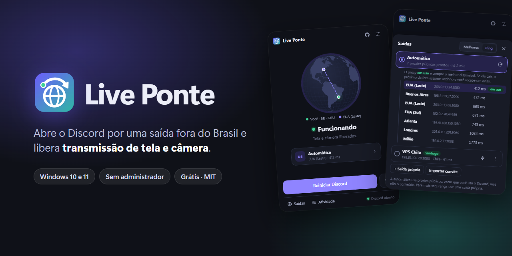
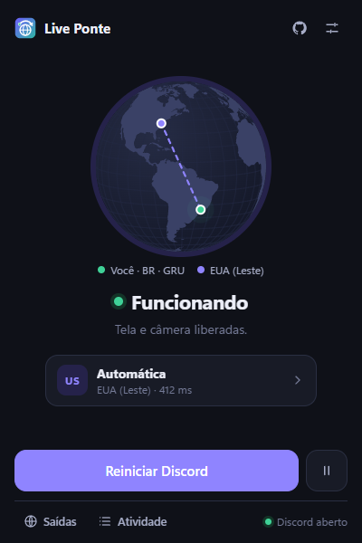
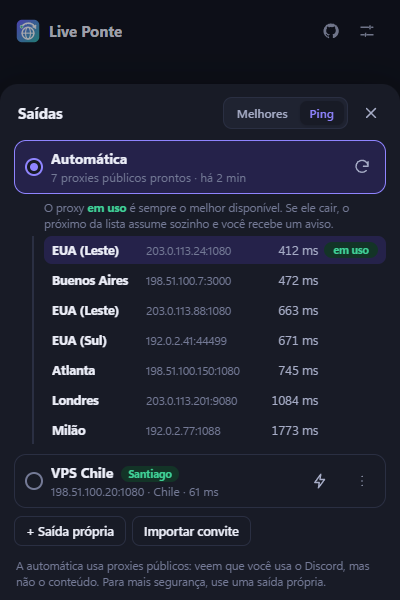
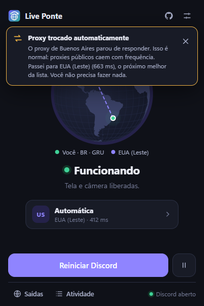
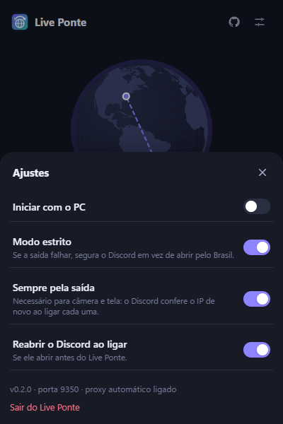
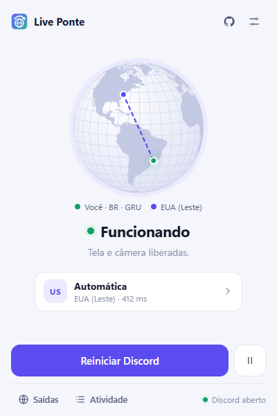

<p align="center">
  
</p>

<p align="center">
  <a href="../../releases/latest"><b>⬇ Baixar para Windows</b></a> ·
  Windows 10 e 11 · sem administrador · sem conta · grátis
</p>

---

Desde agosto de 2026, por uma medida cautelar da ANPD, o Discord desativou no Brasil a
transmissão de tela (Go Live) e a câmera. O Discord decide isso pelo IP que enxerga. O
Live Ponte faz o tráfego de controle do Discord sair por um proxy em outro país; **voz, câmera e
tela continuam indo direto**, então o ping não muda.

> **Projeto independente.** Não tem relação com o Discord Inc. Contornar uma restrição regional
> pode violar os termos de uso do Discord; a decisão de usar é de cada pessoa.

## Telas

<p align="center">
  
  
  
</p>
<p align="center">
  
  
</p>

## Como usar

1. Baixe o instalador em [Releases](../../releases) e instale (não pede administrador).
2. Abra o Live Ponte. Ele busca sozinho proxies públicos **perto de você** e testa cada um
   contra o próprio Discord. Só ficam os que o Discord coloca fora da região Brasil.
3. Clique em **Reiniciar Discord** e espere aparecer **Funcionando**.

**Todo mundo da chamada precisa usar**, inclusive quem só assiste: o bloqueio vale para os dois
lados.

## Saídas

| Saída | Como é | Segurança |
|---|---|---|
| **Automática** (padrão) | Listas públicas atualizadas a cada início ([monosans](https://github.com/monosans/proxy-list), [proxifly](https://github.com/proxifly/free-proxy-list), [TheSpeedX](https://github.com/TheSpeedX/PROXY-List), ProxyScrape), testadas e ordenadas por proximidade e ping. Se o proxy em uso cair, o próximo assume e o app avisa. | A conexão com o Discord é criptografada: o proxy **não vê** mensagens nem senha, mas vê que o Discord está sendo usado. |
| **Própria** | Seu proxy SOCKS5 ou HTTP, com usuário e senha (por exemplo, uma VPS grátis da Oracle no Chile). Dá para mandar aos amigos por **código de convite**. | A mais segura e estável. |

## Como funciona

- Um proxy local (127.0.0.1) recebe só o tráfego do Discord, por meio do *proxy automático* do
  Windows (`HKCU`, sem administrador). O resto da internet não passa por ele.
- Os domínios que decidem a região (API, gateway e `latency.discord.media`) saem pela saída
  escolhida. **Testado em 09/11/2026:** o Discord confere o IP de novo quando a câmera ou a
  transmissão de tela é ligada, então essas conexões ficam na saída o tempo todo ("Sempre pela
  saída", ligado de fábrica).
- **Modo estrito:** se a saída cair, o Discord fica esperando em vez de abrir pelo IP brasileiro
  sem você perceber.
- Ao sair ou desinstalar, o proxy automático do Windows volta ao valor anterior.

## Desenvolvimento

Requisitos: [Rust](https://rustup.rs), Visual Studio Build Tools (C++), Node.js.

```powershell
npm install
npm run tauri dev     # roda o app com recarga
npm run tauri build   # gera o instalador em src-tauri/target/release/bundle/nsis
```

Testes do núcleo: `cargo test` em `src-tauri`.

## Créditos

Inspirado no [FOL-discord](https://github.com/schacal/FOL-discord) (MIT), de onde vêm a ideia da
janela de abertura, as regras de rota e o uso do proxy automático do Windows.

## Licença

[MIT](LICENSE). Avisos de terceiros em [THIRD_PARTY_NOTICES.md](THIRD_PARTY_NOTICES.md).
